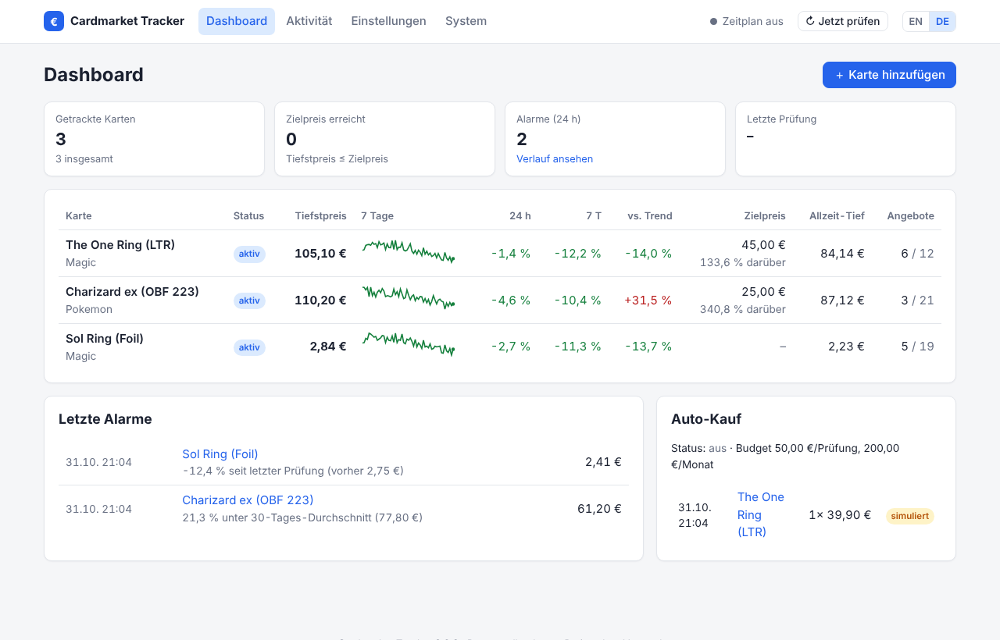

<div align="center">


# Cardmarket Tracker

**Selbst gehosteter Preis-Tracker, Alert-Bot und Dashboard für [Cardmarket](https://www.cardmarket.com)**

[](https://github.com/mgummich/cardmarkettracker/actions/workflows/ci.yml)
[](https://github.com/mgummich/cardmarkettracker/pkgs/container/cardmarkettracker)
[](https://mgummich.github.io/cardmarkettracker/de/)
[](LICENSE)

[Dokumentation](https://mgummich.github.io/cardmarkettracker/de/) ·
[Documentation (English)](https://mgummich.github.io/cardmarkettracker/) ·
[README in English](README.md)

</div>

Verfolge die Magic-, Pokémon-, Yu-Gi-Oh!- … Karten, die du suchst, filtere Angebote genau so,
wie du kaufst, werde benachrichtigt, sobald ein Preis unter dein Ziel fällt, und behalte alles
in einem Web-Dashboard im Blick – auf deinem eigenen Server, NAS oder Raspberry Pi.



## Funktionen

- **Deutsch & Englisch** – Weboberfläche mit EN/DE-Umschalter, Nachrichten und Berichte in
  deiner Sprache (`general.language: de`)
- **Web-Dashboard** – aktueller Tiefstpreis, 7-Tage-Verlauf, Änderung 24 h / 7 T, Abstand zum
  Zielpreis, interaktive Preisdiagramme pro Karte
- **Konfiguration im Browser** – Karten, Filter, Alarme, Zeitplan, Berichte, Auto-Kauf;
  Änderungen greifen sofort, die `config.yaml` behält Kommentare und `${ENV}`-Platzhalter
- **Filter** – Sprachen, Mindestzustand, Foil / signiert / altered / 1. Edition,
  Verkäuferländer, Verkäufertyp, gesperrte Verkäufer, Mindestpreis
- **Preisalarme** – Zielpreis, Preissturz, X % unter Trend / Durchschnitt, Allzeit-Tief, schlaue Wartezeit
- **Benachrichtigungen** – Telegram, Discord, ntfy, E-Mail, Webhook (Home Assistant, n8n, …)
- **Berichte** – täglicher HTML-Bericht, CSV-Export, JSON-API
- **Auto-Kauf (experimentell)** – Probelauf oder Warenkorb über die Cardmarket-API, mit Budgets
- **Datenquellen** – offizielle Cardmarket-API, HTML-Scraper als Notlösung, Demo-Modus
- **Einfacher Betrieb** – ein Docker-Image für `amd64` und `arm64`, SQLite, kein Cloud-Konto

## Schnellstart

```bash
mkdir cardmarket-tracker && cd cardmarket-tracker
curl -LO https://raw.githubusercontent.com/mgummich/cardmarkettracker/main/docker-compose.yml
curl -L -o .env https://raw.githubusercontent.com/mgummich/cardmarkettracker/main/.env.example
mkdir -p config data && sudo chown -R 1000:1000 config data
# WEB_PASSWORD in der .env setzen, dann:
docker compose up -d
```

**http://localhost:8080** öffnen (Benutzer `admin`) und die erste Karte anlegen. Für deutsche
Nachrichten und Berichte unter *Einstellungen → Prüfung & Sprache* auf Deutsch stellen. Die
Start-Konfiguration nutzt simulierte Demo-Daten – du kannst alles ausprobieren, bevor du die
Cardmarket-API anbindest.

Ohne Docker: `pip install .` und `cmtracker run` – siehe
[Installationsanleitung](https://mgummich.github.io/cardmarkettracker/de/getting-started/installation/).

## Dokumentation

Vollständige Dokumentation auf **Deutsch und Englisch**: <https://mgummich.github.io/cardmarkettracker/de/>

| | |
|---|---|
| [Installation](https://mgummich.github.io/cardmarkettracker/de/getting-started/installation/) | Docker, pip, systemd, Updates |
| [Konfigurationsreferenz](https://mgummich.github.io/cardmarkettracker/de/configuration/reference/) | alle Optionen mit Standardwerten |
| [Datenquellen](https://mgummich.github.io/cardmarkettracker/de/configuration/data-sources/) | Cardmarket-API-Zugang, Scraper, Demo |
| [Benachrichtigungen](https://mgummich.github.io/cardmarkettracker/de/configuration/notifications/) | Telegram, Discord, ntfy, E-Mail, Webhook |
| [Deployment](https://mgummich.github.io/cardmarkettracker/de/operations/deployment/) | Reverse-Proxy, Raspberry Pi, Backups |

## Status

Tracker, Alarme, Berichte und Weboberfläche sind getestet und einsatzbereit. Die Anbindung an
die Cardmarket-API und den Scraper ist gegen aufgezeichnete Antworten getestet; Rückmeldungen
aus dem echten Betrieb sind sehr willkommen. Der Auto-Kauf ist **experimentell**.

## Mitmachen

Fehlerberichte, Ideen und Pull Requests sind willkommen – auf Deutsch oder Englisch. Bitte
[CONTRIBUTING.md](CONTRIBUTING.md) lesen. Sicherheitslücken: siehe [SECURITY.md](SECURITY.md).

## Haftungsausschluss

Unabhängiges Open-Source-Projekt, nicht mit Cardmarket (Sammelkartenmarkt GmbH & Co. KG)
verbunden. Beachte die Nutzungsbedingungen und API-Limits von Cardmarket. Auto-Kauf auf eigene
Verantwortung.

## Lizenz

[MIT](LICENSE)
