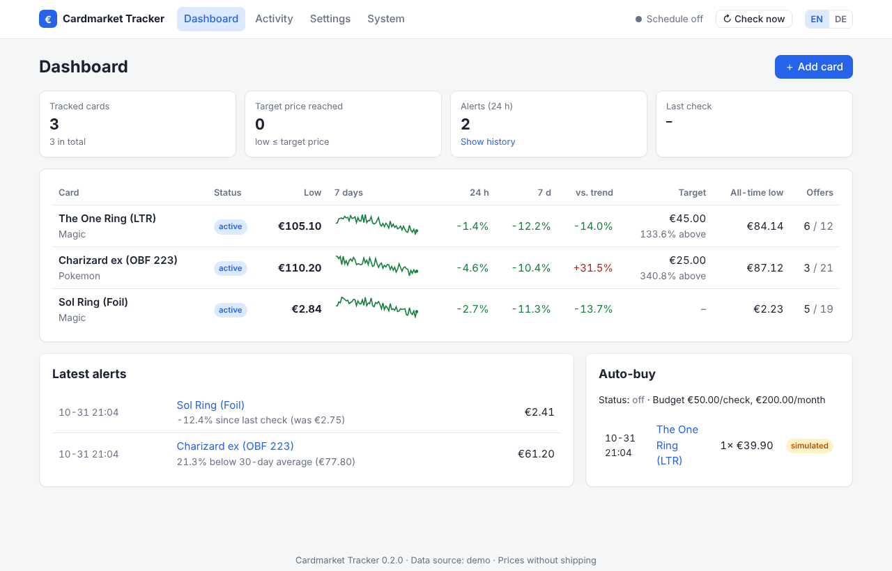

<div align="center">


# Cardmarket Tracker

**Self-hosted price tracker, alert bot and dashboard for [Cardmarket](https://www.cardmarket.com)**

[](https://github.com/mgummich/cardmarkettracker/actions/workflows/ci.yml)
[](https://github.com/mgummich/cardmarkettracker/pkgs/container/cardmarkettracker)
[](https://mgummich.github.io/cardmarkettracker/)
[](LICENSE)


[Documentation](https://mgummich.github.io/cardmarkettracker/) ·
[Dokumentation (Deutsch)](https://mgummich.github.io/cardmarkettracker/de/) ·
[README auf Deutsch](README.de.md)

</div>

Track the Magic, Pokémon, Yu-Gi-Oh! … cards you want, filter offers exactly the way you buy,
get notified when a price drops below your target, and see everything in a web dashboard –
running on your own server, NAS or Raspberry Pi.



## Features

- **English & German** – web UI with EN/DE switch, notifications and reports in your language
- **Web dashboard** – current low, 7-day sparkline, 24 h / 7 d change, distance to target,
  interactive price charts per card
- **Configure in the browser** – cards, filters, alerts, schedule, reports, auto-buy; changes
  apply instantly and `config.yaml` keeps its comments and `${ENV}` placeholders
- **Filters** – languages, minimum condition, foil / signed / altered / 1st edition, seller
  countries, seller type, blocked sellers, minimum price
- **Alerts** – target price, price drop, X % below trend / averages, all-time low, smart cooldown
- **Notifications** – Telegram, Discord, ntfy, e-mail, webhook (Home Assistant, n8n, …)
- **Reports** – daily HTML report, CSV export, JSON API
- **Auto-buy (experimental)** – dry run or add to cart via the Cardmarket API, with budgets
- **Data sources** – official Cardmarket API, HTML scraper fallback, demo mode
- **Easy to run** – one Docker image for `amd64` and `arm64`, SQLite, no cloud account

## Quick start

```bash
mkdir cardmarket-tracker && cd cardmarket-tracker
curl -LO https://raw.githubusercontent.com/mgummich/cardmarkettracker/main/docker-compose.yml
curl -L -o .env https://raw.githubusercontent.com/mgummich/cardmarkettracker/main/.env.example
mkdir -p config data && sudo chown -R 1000:1000 config data
# set WEB_PASSWORD in .env, then:
docker compose up -d
```

Open **http://localhost:8080** (user `admin`) and add your first card. The starter
configuration uses simulated demo data, so you can try everything before connecting the
Cardmarket API.

Without Docker: `pip install .` and `cmtracker run` – see the
[installation guide](https://mgummich.github.io/cardmarkettracker/getting-started/installation/).

## Documentation

Full documentation in **English and German**: <https://mgummich.github.io/cardmarkettracker/>

| | |
|---|---|
| [Installation](https://mgummich.github.io/cardmarkettracker/getting-started/installation/) | Docker, pip, systemd, updating |
| [Configuration reference](https://mgummich.github.io/cardmarkettracker/configuration/reference/) | every option with defaults |
| [Data sources](https://mgummich.github.io/cardmarkettracker/configuration/data-sources/) | Cardmarket API credentials, scraper, demo |
| [Notifications](https://mgummich.github.io/cardmarkettracker/configuration/notifications/) | Telegram, Discord, ntfy, e-mail, webhook |
| [Deployment](https://mgummich.github.io/cardmarkettracker/operations/deployment/) | reverse proxy, Raspberry Pi, backups |

## Status

The tracker, alerts, reports and web UI are tested and usable. The Cardmarket API and
scraper integrations are tested against recorded responses; real-world feedback is very
welcome. Auto-buy is **experimental**.

## Contributing

Bug reports, ideas and pull requests are welcome – in English or German. Please read
[CONTRIBUTING.md](CONTRIBUTING.md). Security issues: see [SECURITY.md](SECURITY.md).

## Disclaimer

Independent open source project, not affiliated with Cardmarket (Sammelkartenmarkt GmbH & Co. KG).
Respect Cardmarket's terms of service and API limits. Use auto-buy at your own risk.

## License

[MIT](LICENSE)
