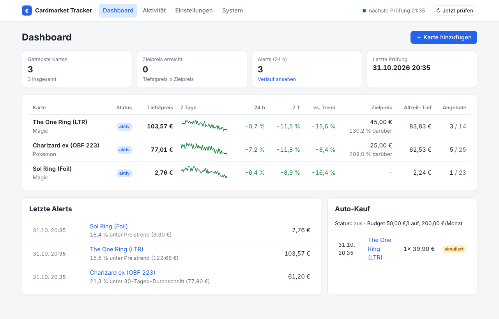
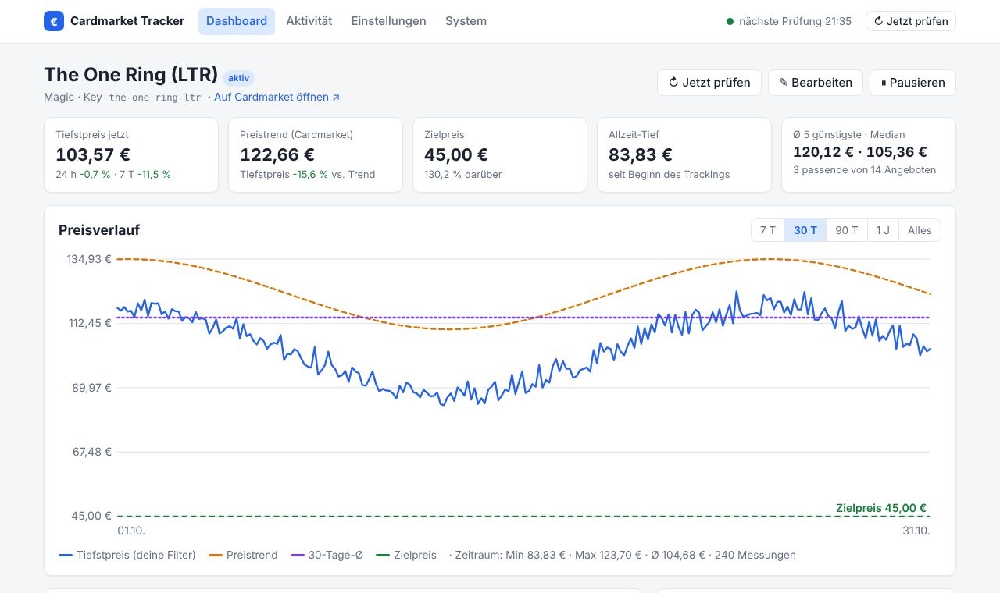
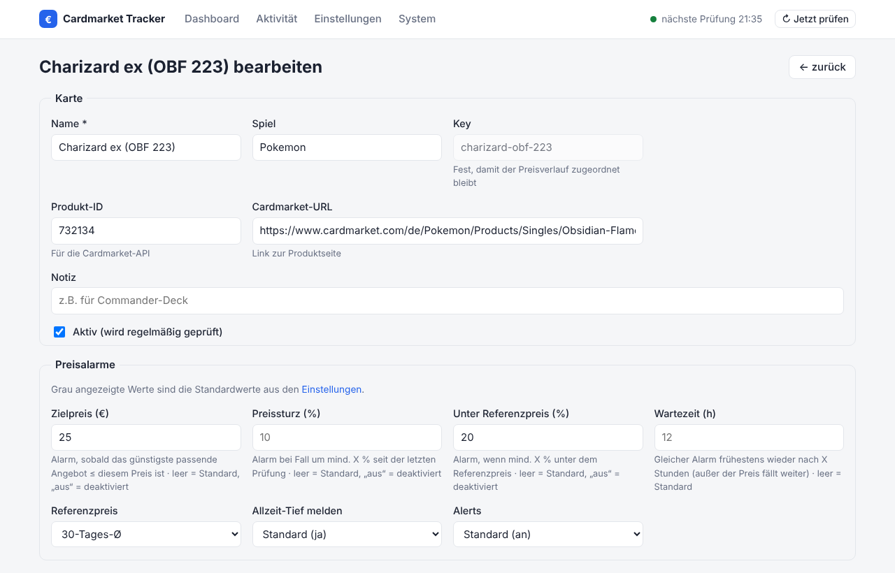

# Cardmarket Tracker

Selbst gehosteter Bot, der die Preise ausgewählter Karten auf [Cardmarket](https://www.cardmarket.com)
überwacht – mit frei einstellbaren Filtern (Sprache, Zustand, Foil, Verkäuferland, …),
**Alerts bei Preisunterschreitungen**, einem **ausführlichen HTML-Bericht** und einem
(experimentellen) **Auto-Kauf**-Modul.



## Funktionen

- **Weboberfläche** – Dashboard mit allen Karten (Tiefstpreis, Mini-Verlauf, Änderung 24 h/7 T,
  Abstand zum Zielpreis, Status), Detailseite je Karte mit interaktivem Preisdiagramm,
  Angeboten, Alerts und Käufen; Karten, Filter, Alarme, Intervall, Bericht und Auto-Kauf
  **direkt im Browser konfigurieren** – Änderungen greifen sofort, ohne Neustart
- **Watchlist** – beliebig viele Karten, globale Standardfilter, je Karte überschreibbar
- **Filter**: Sprachen, Mindestzustand (MT…PO), Foil, signiert, altered, 1. Edition,
  Verkäuferländer (Whitelist/Blacklist), Verkäufertyp (privat/gewerblich/Powerseller),
  gesperrte Verkäufer, Mindestpreis (gegen Lockangebote)
- **Alert-Regeln** (kombinierbar):
  - Zielpreis – günstigstes passendes Angebot ≤ Zielpreis
  - Preissturz um X % seit der letzten Prüfung
  - X % unter Preistrend / 1-, 7-, 30-Tage-Schnitt / ab-Preis
  - neues Allzeit-Tief in der eigenen Historie
  - Wartezeit gegen Spam – fällt der Preis weiter, wird trotzdem sofort erneut gemeldet
- **Benachrichtigungen**: Telegram, Discord, ntfy, E-Mail (SMTP), generischer Webhook
  (Home Assistant, n8n, …), Konsole – pro Kanal wählbar, welche Ereignisse ankommen
- **Bericht**: HTML (Darkmode, Verlaufsdiagramm, Kennzahlen 24 h / 7 T / 30 T, Allzeit-Tief,
  günstigste Angebote, Alert-Historie) – täglich automatisch, optional als Anhang verschickt;
  CSV-Export des Verlaufs, JSON-API für eigene Integrationen
- **Auto-Kauf (experimentell)**: Probelauf oder „in den Warenkorb legen“ über die API, mit
  Stückzahl-, Preis-, Lauf- und Monatsbudget-Grenzen
- **Datenquellen**: offizielle Cardmarket-API, HTML-Scraper als Fallback, Demo-Modus
- Docker-Image (amd64/arm64, z.B. Raspberry Pi), GitHub Actions CI

## Schnellstart

### Mit Docker (empfohlen)

```bash
git clone https://github.com/mgummich/cardmarkettracker.git
cd cardmarkettracker
cp .env.example .env            # mindestens WEB_PASSWORD setzen!
docker compose up -d --build
```

Dann **http://localhost:8080** öffnen (Benutzer `admin`, Passwort aus `WEB_PASSWORD`) und
Karten über „＋ Karte hinzufügen“ anlegen. Beim ersten Start wird `config/config.yaml`
automatisch angelegt (Demo-Daten). Alternativ vorher die kommentierte Vorlage kopieren:
`mkdir -p config && cp config.example.yaml config/config.yaml`.

Einzelbefehle im Container: `docker compose exec tracker cmtracker check` (bzw. `report`,
`validate`, `test-notify`, …). Logs: `docker compose logs -f`.

> Die Ordner `config/` und `data/` müssen für den Container (UID 1000) beschreibbar sein:
> `mkdir -p config data && sudo chown -R 1000:1000 config data`

### Ohne Docker

Python ≥ 3.11:

```bash
python -m venv .venv && source .venv/bin/activate
pip install -e .
cp config.example.yaml config.yaml
cmtracker run             # Tracker + Weboberfläche auf http://127.0.0.1:8080
```

Die Beispielkonfiguration nutzt den **Demo-Provider** mit simulierten Preisen – so kannst du
Dashboard, Alerts, Berichte und Benachrichtigungen ohne Cardmarket-Zugang ausprobieren.

## Weboberfläche

| | |
|---|---|
|  |  |

- **Dashboard** – alle Karten auf einen Blick, letzte Alerts und Käufe, „↻ Jetzt prüfen“
- **Kartendetail** – Preisverlauf (7 T / 30 T / 90 T / 1 J / alles, Werte per Mouse-over),
  Zielpreis-Linie, Kennzahlen, günstigste Angebote, Alerts, Käufe; pausieren, prüfen, bearbeiten
- **Karte anlegen/bearbeiten** – alle Filter und Regeln; „Standard“ übernimmt die
  Standardwerte, die grau als Platzhalter angezeigt werden
- **Einstellungen** – Standardfilter und -alarme, Intervall, Datenquelle, Bericht, Auto-Kauf
- **System** – Status des Hintergrunddienstes, Benachrichtigungskanäle (maskiert) mit
  Testnachricht, Berichte erzeugen/ansehen, API-Links
- **Aktivität** – alle Alerts und (simulierten) Käufe

So speichert die Oberfläche:

- Änderungen werden in die `config.yaml` geschrieben – **Kommentare, Reihenfolge und
  `${ENV}`-Platzhalter bleiben erhalten**. Vor dem Schreiben wird alles geprüft; bei Fehlern
  bleibt die Datei unverändert. Die vorige Version liegt als `config.yaml.bak` daneben.
- Felder, deren Wert aus einer Umgebungsvariable kommt, sind gesperrt (Badge `${ENV}`).
- Geheimnisse (API-Tokens, Bot-Tokens, Passwörter) und Benachrichtigungskanäle werden bewusst
  **nicht** im Browser bearbeitet, sondern in `config.yaml`/`.env`.
- Auch Änderungen direkt an der Datei werden automatisch übernommen. Eine fehlerhafte Datei
  wird gemeldet, und die letzte gültige Konfiguration läuft weiter.

**Sicherheit:** Mit `web.password` (z.B. `${WEB_PASSWORD}`) ist die Oberfläche per
Benutzer/Passwort geschützt. Formulare akzeptieren nur Anfragen von der eigenen Seite
(CSRF-Schutz). Ohne Docker lauscht sie standardmäßig nur auf `127.0.0.1`. Willst du sie aus
dem Internet erreichen, setz ein Passwort und einen Reverse-Proxy mit HTTPS davor (Caddy,
Traefik, nginx …).

**JSON-API:** `GET /api/cards`, `GET /api/cards/<key>/history?days=30`, `GET /api/status`;
Dokumentation unter `/api/docs`.

## Befehle

| Befehl | Beschreibung |
|---|---|
| `cmtracker run [--no-web] [--host H] [--port P]` | Dauerbetrieb: Zeitplan, Tagesbericht und Weboberfläche |
| `cmtracker web` | nur Weboberfläche (Prüfungen nur per Knopfdruck) |
| `cmtracker check [--card KEY]` | einmalige Prüfung (aller oder einzelner Karten) |
| `cmtracker report [--send]` | HTML-Bericht erzeugen (und Zusammenfassung verschicken) |
| `cmtracker validate` | Konfiguration prüfen, effektive Filter/Regeln je Karte anzeigen |
| `cmtracker test-notify` | Testnachricht an alle Kanäle |
| `cmtracker history KEY [--days 30]` | Preisverlauf im Terminal |
| `cmtracker export KEY -o datei.csv` | Verlauf als CSV |
| `cmtracker purchases` | (simulierte) Käufe anzeigen |
| `cmtracker serve [--port 8080]` | nur den Berichtsordner per HTTP ausliefern |

Konfigurationsdatei: `-c pfad.yaml` oder Umgebungsvariable `CMTRACKER_CONFIG`.

## Konfiguration

Alles steht kommentiert in [`config.example.yaml`](config.example.yaml). Kurzfassung:

```yaml
provider:
  type: mkm_api                # demo | mkm_api | scraper

defaults:                      # gilt für alle Karten …
  filters:
    languages: [German, English]
    min_condition: EX
    foil: false
  alerts:
    drop_percent: 10
    below_reference_percent: 15
    reference: trend
    cooldown_hours: 12

cards:
  - name: "The One Ring"
    product_id: 710549         # für mkm_api
    url: https://www.cardmarket.com/de/Magic/Products/Singles/...   # für scraper
    filters:                   # … und wird hier je Karte überschrieben
      languages: [German]
    alerts:
      max_price: 45
    buy:
      enabled: true
      max_price: 40
      quantity: 1

notifications:
  - type: telegram
    bot_token: ${TELEGRAM_BOT_TOKEN}
    chat_id: ${TELEGRAM_CHAT_ID}
```

- `${VAR}` / `${VAR:-standard}` wird durch Umgebungsvariablen ersetzt – Geheimnisse gehören
  in die `.env`, nicht in die YAML.
- Sprachen, Zustände und Länder verstehen deutsche und englische Schreibweisen
  (`de`, `Deutsch`, `German`; `NM`, `near mint`; `DE`, `Deutschland`).
- `null` bei einem Filter heißt „egal“ (z.B. `languages: null` überschreibt die Standard-Sprachen).
- Dieselbe Karte mehrfach mit verschiedenen Filtern tracken: unterschiedliche `key` vergeben.
- Ist ein Filter gesetzt und ein Angebotsattribut unbekannt, wird das Angebot **verworfen**
  (lieber ein Alarm zu wenig als ein Fehlkauf).

## Datenquellen

### `mkm_api` – offizielle Cardmarket-API (empfohlen)

Nutzt die [MKM API 2.0](https://api.cardmarket.com/ws/documentation) mit OAuth 1.0a.
Du brauchst eine „Dedicated App“ samt Access-Token (Cardmarket-Account → Einstellungen → API).
**Hinweis:** Cardmarket vergibt API-Zugänge nicht (mehr) an jeden Account – prüfe, ob dein
Account Zugriff bekommt. Die Produkt-ID einer Karte liefert z.B. die API-Suche
(`GET /products/find?search=...`).

Pro Karte und Prüfung fallen 1 + ⌈Angebote/100⌉ Requests an. Achte auf das Tageslimit deines
Zugangs (bei 20 Karten und stündlicher Prüfung ≈ 1.000 Requests/Tag).

### `scraper` – öffentliche Produktseite

Liest die Produktseite auf cardmarket.com (erste Seite, also die günstigsten ~50 Angebote).
Cardmarket nutzt einen Bot-Schutz (Cloudflare), Abrufe können daher mit HTTP 403 scheitern,
und Änderungen am HTML können den Parser brechen. Bitte großzügige Intervalle verwenden und die
Nutzungsbedingungen von Cardmarket beachten. Filter werden als URL-Parameter mitgegeben und
zusätzlich lokal angewandt.

### `demo`

Reproduzierbare Fake-Daten – zum Ausprobieren und Entwickeln.

## Auto-Kauf (experimentell)

Gekauft wird **nur**, wenn alles zutrifft:

1. `purchasing.enabled: true` (global) **und** `buy.enabled: true` bei der Karte
2. Angebot erfüllt die Karten- und die (optional strengeren) `buy.filters`
3. Preis ≤ `buy.max_price` und gewünschte `buy.quantity` noch nicht erreicht
4. Budget pro Lauf (`max_per_run`) und pro Kalendermonat (`max_per_month`) reicht

| Modus | Verhalten |
|---|---|
| `dry_run` (Standard) | nichts wird gekauft – nur protokolliert und gemeldet |
| `cart` | Artikel wird über die API in deinen Cardmarket-Warenkorb gelegt; **bezahlen musst du selbst** |

Versandkosten werden aktuell nicht berücksichtigt. Teste neue Regeln immer erst im `dry_run`.

## Entwicklung

```bash
pip install -e '.[dev]'
pytest
ruff check . && ruff format .
```

Aufbau (`src/cmtracker/`):

| Modul | Aufgabe |
|---|---|
| `config.py` | YAML laden, `${ENV}`-Ersetzung, Validierung (pydantic), Defaults mergen |
| `providers/` | Datenquellen: `mkm_api` (inkl. OAuth), `scraper`, `demo` |
| `filters.py` | Angebotsfilter + Snapshot-Berechnung |
| `alerts.py` | Alert-Regeln, Cooldown, Nachrichtentext |
| `tracker.py` | Ablauf je Karte: abrufen → filtern → speichern → Alerts → Kauf |
| `storage.py` | SQLite: Verlauf, gesendete Alerts, Käufe |
| `notifiers/` | Telegram, Discord, ntfy, E-Mail, Webhook, Konsole |
| `runtime.py` | Hintergrunddienst: Zeitplan, „Jetzt prüfen“, automatisches Neuladen der Konfiguration |
| `web/` | Weboberfläche (FastAPI + Jinja2): Dashboard, Formulare, `config.yaml`-Speicher, JSON-API |
| `reports/` | HTML-Bericht (Jinja2 + SVG-Diagramme), Text-Zusammenfassung, CSV |
| `purchasing/` | Kaufplanung (Budget/Stückzahl) und Ausführung (Probelauf/Warenkorb) |
| `app.py`, `cli.py` | Verdrahtung, Kommandozeile |

Neue Datenquelle: `PriceProvider` aus `providers/base.py` implementieren und in
`providers/__init__.py` registrieren. Neuer Kanal: `Notifier` aus `notifiers/base.py`.

## Roadmap

- [ ] Versandkosten je Verkäufer in Alerts und Kaufentscheidung einbeziehen
- [ ] Warenkorb-Optimierung (mehrere Karten beim selben Verkäufer bündeln)
- [ ] Vollautomatischer Checkout (sofern von der API unterstützt), mit Bestätigung per Telegram
- [ ] Kartensuche per Name statt Produkt-ID (`cmtracker search`)
- [x] Weboberfläche mit Dashboard und Konfiguration
- [ ] Benachrichtigungskanäle in der Weboberfläche verwalten
- [ ] Verkäuferbewertung als Filter

## Haftungsausschluss

Inoffizielles Projekt, nicht mit Cardmarket (Sammelkartenmarkt GmbH & Co. KG) verbunden.
Nutzung auf eigene Verantwortung – insbesondere beim automatischen Kauf.

## Lizenz

[MIT](LICENSE)
