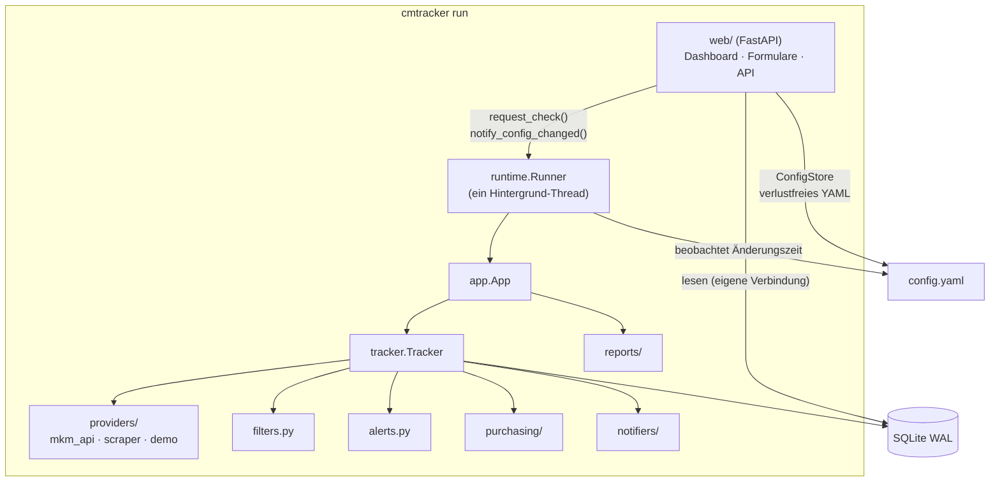

# Architektur



## Module

| Modul | Aufgabe |
|---|---|
| `config.py` | Pydantic-Modelle, YAML laden, `${ENV}`-Ersetzung, Standardwerte mit Karten-Overrides zusammenführen |
| `constants.py` | Zustände, Sprachen, Länder, Verkäufertypen + Normalisierung (deutsche/englische Eingaben) |
| `models.py` | `Offer`, `PriceGuide`, `MarketData`, `Snapshot` |
| `providers/` | Datenquellen mit `PriceProvider.fetch(card, filters) -> MarketData`; OAuth-1.0a-Signatur |
| `filters.py` | wendet `OfferFilter` an, baut einen `Snapshot` |
| `alerts.py` | Regelauswertung, Wartezeit, Nachrichtentext |
| `tracker.py` | pro Karte: abrufen → filtern → speichern → Alarme → Auto-Kauf; Fehler bleiben auf die Karte begrenzt |
| `storage.py` | SQLite (WAL): Snapshots, Alarme, Käufe, Meta/Status |
| `notifiers/` | Kanäle + `NotificationHub` (Ereignis-Routing, Fehlerisolierung) |
| `purchasing/` | `plan_purchases` (Stückzahl, Budget) und Ausführung (Probelauf, Warenkorb) |
| `reports/` | HTML-Bericht (Jinja2), SVG-Diagramme, Text-Zusammenfassung, CSV |
| `runtime.py` | `Runner`: besitzt die `App` in einem Thread; Zeitplan, manuelle Aufträge, Neuladen |
| `web/` | FastAPI-App, `ConfigStore` (ruamel.yaml), Formular ↔ YAML, Templates |
| `cli.py` | `argparse`-Befehle |
| `i18n.py`, `locales/` | Übersetzungen: englische Quelltexte in `_()`, deutscher Katalog in `locales/de.py`, aktive Sprache in einer `ContextVar` |

## Designentscheidungen

- **Ein besitzender Thread.** HTTP-Clients und die schreibende SQLite-Verbindung gehören dem
  Runner-Thread. Die Web-Schicht schickt ihm nur Aufträge und öffnet eigene, kurzlebige
  Leseverbindungen – keine Sperren in der Fachlogik.
- **Die Konfigurationsdatei ist die Wahrheit.** Die Oberfläche bearbeitet die `config.yaml`
  statt einer Datenbank, damit das Setup lesbar, vergleichbar und leicht zu sichern bleibt.
  ruamel.yaml erhält Kommentare.
- **Im Zweifel nicht passend.** Unbekannte Angebotsattribute passen nie zu einem aktiven Filter.
- **Kein JavaScript-Framework.** Serverseitiges Jinja2 mit wenigen Zeilen Vanilla-JS;
  Diagramme entstehen serverseitig als SVG.

## Datenbank

| Tabelle | Inhalt |
|---|---|
| `snapshots` | eine Zeile pro Karte und Prüfung: Anzahlen, Tiefst-/Ø5-/Medianpreis, Preisübersicht, günstigste Angebote als JSON |
| `alerts` | verschickte Alarme (für die Wartezeit) |
| `purchases` | (simulierte) Käufe mit Modus und Status |
| `meta` | Schlüssel/Wert: Datum des letzten Berichts, Status je Karte |

Das Schema entsteht per `CREATE TABLE IF NOT EXISTS`; neue Spalten kommen mit expliziten Migrationen.

## Erweitern

=== "Neue Datenquelle"

    ```python
    from cmtracker.providers.base import PriceProvider, ProviderError
    from cmtracker.models import MarketData, Offer, PriceGuide


    class MeinProvider(PriceProvider):
        name = "mein"

        def fetch(self, card, filters) -> MarketData:
            ...  # bei Fehlern ProviderError("…") werfen
            return MarketData(offers=[Offer(price=1.0, seller="x")], price_guide=PriceGuide())
    ```

    In `providers/__init__.py:create_provider` registrieren und ein Konfigurationsmodell in
    `config.py` ergänzen.

=== "Neuer Benachrichtigungskanal"

    ```python
    from cmtracker.notifiers.base import Notification, Notifier


    class MeinNotifier(Notifier):
        def send(
            self, n: Notification
        ) -> None: ...  # bei Fehlern Exception werfen; der Hub protokolliert und macht weiter
    ```

    Ein Konfigurationsmodell (mit `type: Literal["mein"]`) zur Union `NotifierConfig` hinzufügen
    und in `notifiers/__init__.py` registrieren.
