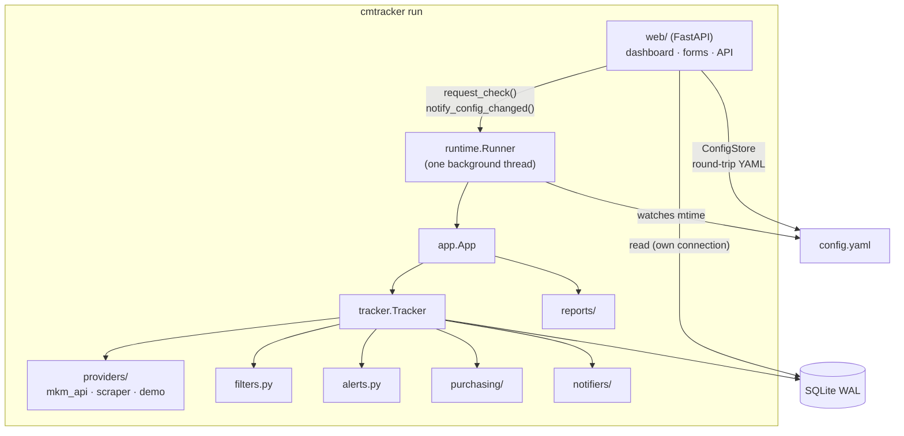

# Architecture



## Modules

| Module | Responsibility |
|---|---|
| `config.py` | Pydantic models, YAML loading, `${ENV}` expansion, merging defaults with card overrides |
| `constants.py` | conditions, languages, countries, seller types + normalisation (German/English input) |
| `models.py` | `Offer`, `PriceGuide`, `MarketData`, `Snapshot` |
| `providers/` | data sources implementing `PriceProvider.fetch(card, filters) -> MarketData`; OAuth 1.0a signing |
| `filters.py` | applies `OfferFilter`, builds a `Snapshot` |
| `alerts.py` | rule evaluation, cooldown, message text |
| `tracker.py` | per card: fetch → filter → store → alerts → auto-buy; errors are isolated per card |
| `storage.py` | SQLite (WAL): snapshots, alerts, purchases, meta/status |
| `notifiers/` | channels + `NotificationHub` (event routing, error isolation) |
| `purchasing/` | `plan_purchases` (quantity, budget) and executors (dry run, cart) |
| `reports/` | HTML report (Jinja2), SVG charts, text summary, CSV |
| `runtime.py` | `Runner`: owns the `App` in one thread; schedule, manual requests, config reload |
| `web/` | FastAPI app, `ConfigStore` (ruamel.yaml round-trip), form ↔ YAML mapping, templates |
| `cli.py` | `argparse` commands |

## Design decisions

- **One owner thread.** HTTP clients and the SQLite connection used for writing belong to the
  runner thread. The web layer only sends requests to it and opens its own short-lived
  read connections – no locking in business logic.
- **Config file is the source of truth.** The web UI edits `config.yaml` instead of a database,
  so the setup stays reviewable, diffable and easy to back up. ruamel.yaml keeps comments.
- **Fail closed in filters.** Unknown offer attributes never match an active filter.
- **No JavaScript framework.** Server-rendered Jinja2 with a few lines of vanilla JS; charts
  are generated as SVG on the server.

## Database

| Table | Content |
|---|---|
| `snapshots` | one row per card and check: counts, low / avg5 / median, price guide, cheapest offers as JSON |
| `alerts` | sent alerts (used for the cooldown) |
| `purchases` | (simulated) purchases with mode and status |
| `meta` | key/value: last report date, per-card status |

The schema is created with `CREATE TABLE IF NOT EXISTS`; new columns will come with explicit
migrations.

## Extending

=== "New data source"

    ```python
    from cmtracker.providers.base import PriceProvider, ProviderError
    from cmtracker.models import MarketData, Offer, PriceGuide


    class MyProvider(PriceProvider):
        name = "mine"

        def fetch(self, card, filters) -> MarketData:
            ...  # raise ProviderError("…") on failures
            return MarketData(offers=[Offer(price=1.0, seller="x")], price_guide=PriceGuide())
    ```

    Register it in `providers/__init__.py:create_provider` and add a config model in `config.py`.

=== "New notification channel"

    ```python
    from cmtracker.notifiers.base import Notification, Notifier


    class MyNotifier(Notifier):
        def send(self, n: Notification) -> None: ...  # raise on failure; the hub logs and continues
    ```

    Add a config model (with `type: Literal["mine"]`) to the `NotifierConfig` union and register
    it in `notifiers/__init__.py`.
