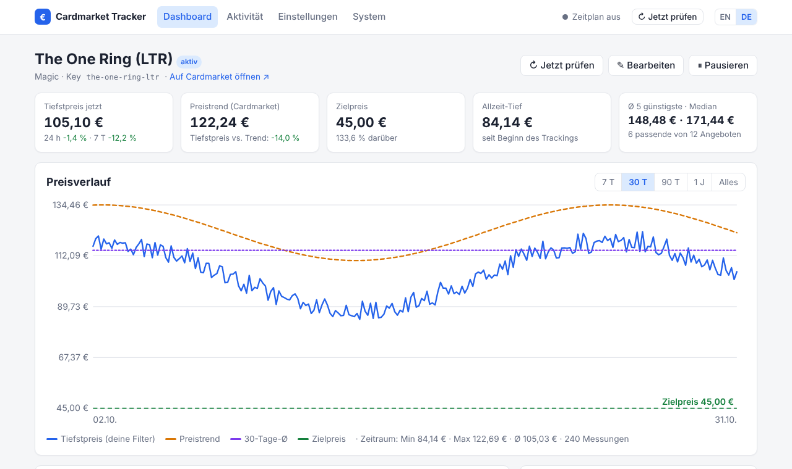

# Schnellstart

Diese Anleitung nutzt die **Demo**-Datenquelle – du kannst alles ohne Cardmarket-API-Zugang
ausprobieren. Der Wechsel auf echte Daten ist eine Einstellung (siehe [Datenquellen](../configuration/data-sources.md)).

## 1. Tracker starten

[Installation](installation.md) durchführen und die Weboberfläche unter `http://localhost:8080`
öffnen. Das Dashboard ist noch leer:

> 🃏 **Noch keine Karten** – Lege deine erste Karte an …

## 2. Karte anlegen

Auf **＋ Karte hinzufügen** klicken und ausfüllen:

| Feld | Beispiel | Hinweis |
|---|---|---|
| Name | `The One Ring (LTR)` | freier Text |
| Spiel | `Magic` | |
| Produkt-ID | `710549` | Pflicht für die Cardmarket-API |
| Cardmarket-URL | `https://www.cardmarket.com/de/Magic/Products/Singles/…` | Pflicht für den Scraper |
| Zielpreis | `45` | Alarm, sobald das günstigste passende Angebot ≤ 45 € ist |

Die Oberfläche richtet sich nach deiner Browsersprache; mit **EN / DE** oben rechts
schaltest du zwischen Englisch und Deutsch um.

Für **deutsche Nachrichten und Berichte** in der `config.yaml` `general.language: de` setzen
(oder unter *Einstellungen → Prüfung & Sprache*).

Unter **Filter** wählst du Sprachen und Mindestzustand. Felder auf **Standard** übernehmen die
allgemeinen Werte aus den *Einstellungen*; der jeweils geltende Wert steht grau im Feld.

Speichern – die erste Prüfung startet sofort und du landest auf der Kartenseite.



## 3. Benachrichtigungen einrichten

Benachrichtigungskanäle stehen in der `config.yaml` (Tokens sollen nicht im Browser
bearbeitbar sein). Beispiel Telegram:

```yaml title="config.yaml"
notifications:
  - type: telegram
    bot_token: ${TELEGRAM_BOT_TOKEN}
    chat_id: ${TELEGRAM_CHAT_ID}
```

```bash title=".env"
TELEGRAM_BOT_TOKEN=123456:ABC...
TELEGRAM_CHAT_ID=987654321
```

Container neu starten (Umgebungsvariablen werden beim Start gelesen), dann
**System → Testnachricht senden**. Alle Kanäle: [Benachrichtigungen](../configuration/notifications.md).

## 4. Auf echte Daten umstellen

API-Zugangsdaten in die `.env` eintragen und die Datenquelle setzen:

```yaml title="config.yaml"
provider:
  type: mkm_api
  mkm_api:
    app_token: ${MKM_APP_TOKEN}
    app_secret: ${MKM_APP_SECRET}
    access_token: ${MKM_ACCESS_TOKEN}
    access_token_secret: ${MKM_ACCESS_TOKEN_SECRET}
```

## 5. Feinschliff

- Allgemeine Standardfilter und -alarme unter **Einstellungen → Standardwerte für alle Karten**.
- Prüfintervall (API-Limits beachten) und Uhrzeit des Tagesberichts anpassen.
- [Preisalarme](../usage/alerts.md) erklärt, wie Regeln und Wartezeit zusammenspielen.
