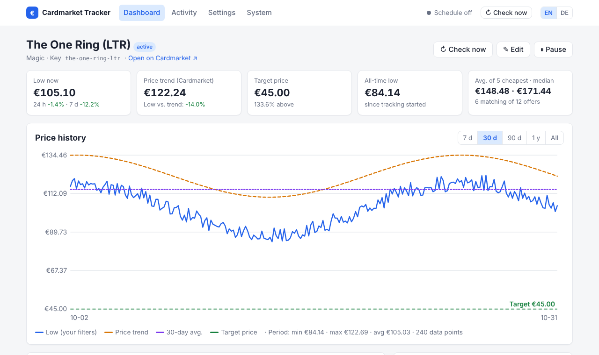

# Quickstart

This walk-through uses the **demo** data source, so you can try everything without Cardmarket
API access. Switching to real data is one setting (see [Data sources](../configuration/data-sources.md)).

## 1. Start the tracker

Follow the [installation](installation.md) and open the web UI at `http://localhost:8080`.
The dashboard is empty:

> 🃏 **No cards yet** – Add your first card …

## 2. Add a card

Click **＋ Add card** and fill in:

| Field | Example | Note |
|---|---|---|
| Name | `The One Ring (LTR)` | free text |
| Game | `Magic` | |
| Product ID | `710549` | required for the Cardmarket API |
| Cardmarket URL | `https://www.cardmarket.com/en/Magic/Products/Singles/…` | required for the scraper |
| Target price | `45` | alert when the cheapest matching offer is ≤ 45 € |

The interface follows your browser language; switch between English and German with
**EN / DE** in the top right corner.

Under **Filters** choose the languages and minimum condition you accept. Fields set to
**Default** use the global defaults from *Settings*; the effective default is shown greyed out.

Save – the first check starts immediately and you land on the card page.



## 3. Get notified

Notification channels live in `config.yaml` (tokens should not be editable from a browser).
Example for Telegram:

```yaml title="config.yaml"
notifications:
  - type: telegram
    bot_token: ${TELEGRAM_BOT_TOKEN}
    chat_id: ${TELEGRAM_CHAT_ID}
```

```bash title=".env"
TELEGRAM_BOT_TOKEN=123456:ABC...
TELEGRAM_CHAT_ID=987654321
```

Restart the container (environment variables are read at start), then use
**System → Send test message**. See [Notifications](../configuration/notifications.md) for all channels.

## 4. Switch to real data

Put your API credentials into `.env` and set the data source:

```yaml title="config.yaml"
provider:
  type: mkm_api
  mkm_api:
    app_token: ${MKM_APP_TOKEN}
    app_secret: ${MKM_APP_SECRET}
    access_token: ${MKM_ACCESS_TOKEN}
    access_token_secret: ${MKM_ACCESS_TOKEN_SECRET}
```

## 5. Fine-tune

- Set global default filters and alert rules in **Settings → Defaults for all cards**.
- Adjust the check interval (mind the API limits) and the daily report time.
- Read [Alerts](../usage/alerts.md) to understand how rules and the cooldown interact.
