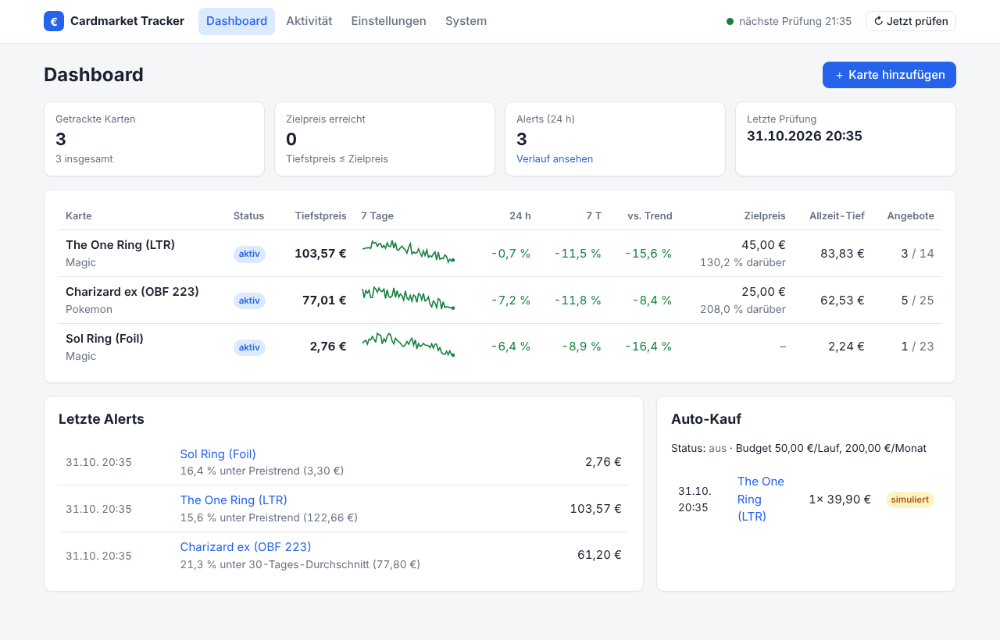
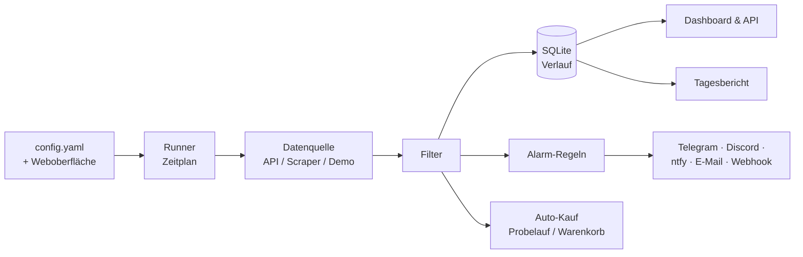

---
hide:
  - navigation
---

# Cardmarket Tracker

**Selbst gehosteter Preis-Tracker, Alert-Bot und Dashboard für [Cardmarket](https://www.cardmarket.com).**
Verfolge die Karten, die du suchst, filtere Angebote genau so, wie du kaufst (Sprache, Zustand,
Foil, Verkäuferland, …), werde benachrichtigt, sobald ein Preis unter dein Ziel fällt, und
behalte alles in einem übersichtlichen Web-Dashboard im Blick.

## Funktionen

-   :material-monitor-dashboard: **Web-Dashboard**

    ---

    Alle Karten auf einen Blick: aktueller Tiefstpreis, 7-Tage-Verlauf, Änderung 24 h / 7 T,
    Abstand zum Zielpreis. Interaktive Preisdiagramme pro Karte.

-   :material-tune: **Konfiguration im Browser**

    ---

    Karten, Filter, Alarme, Zeitplan, Berichte und Auto-Kauf bearbeiten – Änderungen greifen
    sofort. Die `config.yaml` bleibt lesbar: Kommentare und `${ENV}`-Platzhalter bleiben erhalten.

-   :material-filter: **Präzise Filter**

    ---

    Sprachen, Mindestzustand, Foil / signiert / altered / 1. Edition, Verkäuferländer,
    Verkäufertyp, gesperrte Verkäufer, Mindestpreis.

-   :material-bell-ring: **Preisalarme**

    ---

    Zielpreis, Preissturz, X % unter Trend / 1-, 7-, 30-Tage-Schnitt, neues Allzeit-Tief –
    mit Wartezeit, die bei weiter fallendem Preis trotzdem sofort meldet.

-   :material-message-badge: **Benachrichtigungen**

    ---

    Telegram, Discord, ntfy, E-Mail, Webhook (Home Assistant, n8n, …).

-   :material-file-chart: **Berichte**

    ---

    Täglicher HTML-Bericht mit Diagrammen und Kennzahlen, CSV-Export, JSON-API.

-   :material-cart: **Auto-Kauf (experimentell)**

    ---

    Probelauf oder „in den Warenkorb legen“ über die Cardmarket-API – mit Preis-, Stückzahl-
    und Budgetgrenzen.

-   :material-docker: **Selbst gehostet**

    ---

    Ein Docker-Container (amd64 / arm64, läuft auf dem Raspberry Pi), SQLite, kein Cloud-Konto.

## So funktioniert es

1. Nach Zeitplan (Standard: stündlich) holt der Tracker für jede Karte alle Angebote und die
   Preisübersicht.
2. Deine Filter entscheiden, welche Angebote zählen. Das günstigste passende Angebot ist der
   *aktuelle Tiefstpreis* der Karte.
3. Das Ergebnis wird in SQLite gespeichert, mit deinen Alarm-Regeln verglichen und – falls
   aktiviert – mit deinen Kauf-Regeln.
4. Dashboard, Tagesbericht und JSON-API entstehen aus dem gespeicherten Verlauf.

## Weiter geht's

- [Installieren](getting-started/installation.md) mit Docker oder pip
- [Schnellstart](getting-started/quickstart.md): erste Karte und erster Alarm in fünf Minuten
- [Konfigurationsreferenz](configuration/reference.md)

!!! warning "Kein offizielles Cardmarket-Projekt"
    Dies ist ein unabhängiges Open-Source-Projekt und nicht mit Cardmarket
    (Sammelkartenmarkt GmbH & Co. KG) verbunden. Beachte die Nutzungsbedingungen und
    API-Limits von Cardmarket. Der Auto-Kauf ist experimentell – Nutzung auf eigene Verantwortung.
