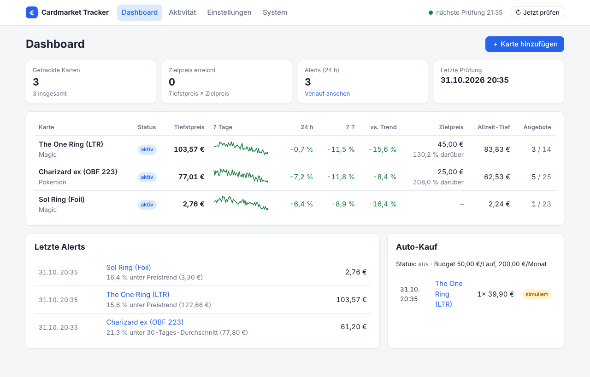
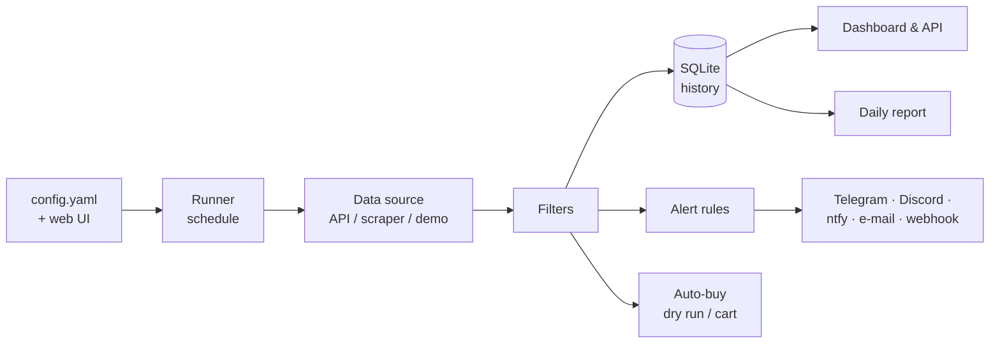

---
hide:
  - navigation
---

# Cardmarket Tracker

**Self-hosted price tracker, alert bot and dashboard for [Cardmarket](https://www.cardmarket.com).**
Track the cards you want, filter offers exactly the way you buy (language, condition, foil,
seller country, …), get notified the moment a price drops below your target and keep an eye on
everything in a clean web dashboard.

## Features

-   :material-monitor-dashboard: **Web dashboard**

    ---

    All cards at a glance: current low, 7-day sparkline, 24 h / 7 d change, distance to your
    target price. Interactive price charts per card.

-   :material-tune: **Configure in the browser**

    ---

    Add and edit cards, filters, alert rules, schedule, reports and auto-buy – changes apply
    instantly. `config.yaml` stays readable: comments and `${ENV}` placeholders are kept.

-   :material-filter: **Precise filters**

    ---

    Languages, minimum condition, foil / signed / altered / 1st edition, seller countries,
    seller type, blocked sellers, minimum price.

-   :material-bell-ring: **Price alerts**

    ---

    Target price, price drop, X % below trend / 1-, 7-, 30-day average, new all-time low –
    with a cooldown that still fires immediately when the price keeps falling.

-   :material-message-badge: **Notifications**

    ---

    Telegram, Discord, ntfy, e-mail, generic webhook (Home Assistant, n8n, …).

-   :material-file-chart: **Reports**

    ---

    Daily HTML report with charts and key figures, CSV export, JSON API.

-   :material-cart: **Auto-buy (experimental)**

    ---

    Dry run or "add to cart" via the Cardmarket API – with price, quantity and budget limits.

-   :material-docker: **Self-hosted**

    ---

    One Docker container (amd64 / arm64, runs on a Raspberry Pi), SQLite, no cloud account.

## How it works

1. On a schedule (default: hourly) the tracker fetches all offers and the price guide for each card.
2. Your filters decide which offers count. The cheapest matching offer is the card's *current low*.
3. The result is stored in SQLite, compared with your alert rules, and – if enabled – with your
   auto-buy rules.
4. The dashboard, the daily report and the JSON API are built from the stored history.

## Next steps

- [Install it](getting-started/installation.md) with Docker or pip
- [Quickstart](getting-started/quickstart.md): your first card and first alert in five minutes
- [Configuration reference](configuration/reference.md)

!!! warning "Not affiliated with Cardmarket"
    This is an independent open source project and not affiliated with Cardmarket
    (Sammelkartenmarkt GmbH & Co. KG). Respect Cardmarket's terms of service and API limits.
    Auto-buy is experimental – use it at your own risk.
