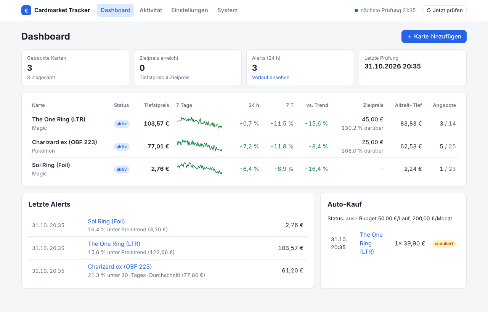
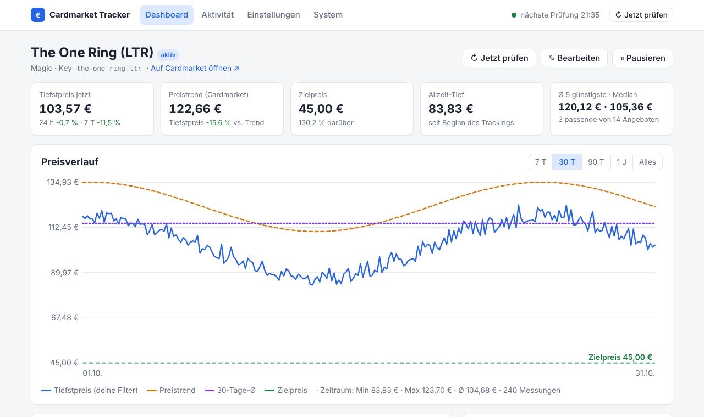
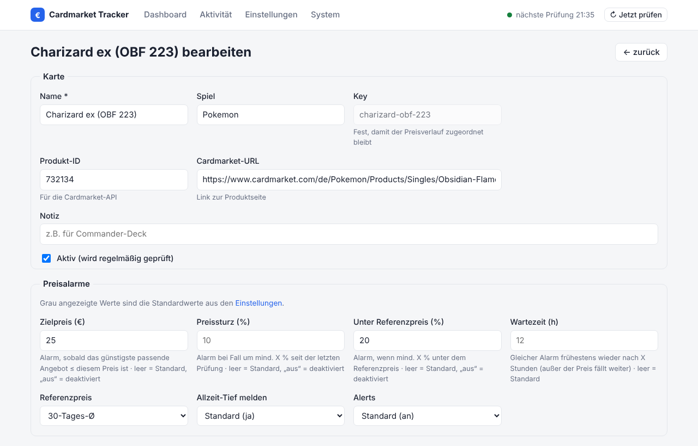

# Weboberfläche

`cmtracker run` startet den Tracker **und** die Weboberfläche (Standard-Port `8080`).

## Dashboard

| Spalte | Bedeutung |
|---|---|
| Status | *aktiv*, *Ziel erreicht*, *Fehler* (letzte Prüfung fehlgeschlagen), *neu* (noch keine Daten), *pausiert* |
| Tiefstpreis | günstigstes Angebot, das **deinen Filtern** entspricht |
| 7 Tage | Mini-Verlauf des Tiefstpreises (grün = fallend) |
| 24 h / 7 T | Änderung des Tiefstpreises gegenüber vor 24 Stunden / 7 Tagen |
| vs. Trend | Tiefstpreis im Vergleich zum Cardmarket-Preistrend |
| Zielpreis | deine Regel `max_price` und der Abstand dazu |
| Allzeit-Tief | niedrigster Tiefstpreis seit Beginn des Trackings |
| Angebote | passende / alle Angebote |

In der Kopfzeile stehen der Status des Hintergrunddienstes (*nächste Prüfung*) und der Knopf
**↻ Jetzt prüfen**. Ist die Prüfung fertig, lädt die Seite automatisch neu.

## Kartenseite

- **Preisverlauf**: Zeitraum 7 T / 30 T / 90 T / 1 J / alles; mit der Maus über einen Punkt
  fahren zeigt den genauen Wert. Linien: dein gefilterter Tiefstpreis, Cardmarket-Trend,
  30-Tage-Schnitt, Zielpreis.
- Kennzahlen, die günstigsten passenden Angebote der letzten Prüfung, Alarme und Käufe.
- Knöpfe: Jetzt prüfen, Bearbeiten, Pausieren / Fortsetzen.

## Karten anlegen und bearbeiten

Jedes Filter- und Alarmfeld kann sein:

| Auswahl | Bedeutung | In der `config.yaml` |
|---|---|---|
| *Standard* | allgemeinen Standardwert verwenden | Schlüssel wird entfernt |
| *egal* | ausdrücklich „egal“ | `null` |
| *Auswahl…* / Wert | bestimmter Wert | der Wert |

Zahlenfelder bei Alarmen: leer lassen = Standard, `aus` eintippen = Regel für diese Karte
abschalten. Dezimalkomma und -punkt werden beide akzeptiert.

Der **Key** ist nach dem Anlegen fest, damit der Preisverlauf auch nach einer Umbenennung
erhalten bleibt. Beim Löschen kann der Verlauf optional mitgelöscht werden.

## Einstellungen

Enthält: Standardwerte für alle Karten (Filter und Alarme), Prüfzeitplan, Datenquelle,
Bericht und Auto-Kauf. Felder, die aus Umgebungsvariablen kommen, sind gesperrt und mit
`${ENV}` markiert.

## System

Zeigt den Hintergrunddienst (letzte / nächste Prüfung, Dauer, Fehler), die
Benachrichtigungskanäle (Ziele maskiert), einen Knopf für eine **Testnachricht**, die
Berichterstellung und Links zur JSON-API.

## Wie gespeichert wird

1. Das Formular wird geprüft; bei Fehlern erscheint eine Meldung und es wird nichts geschrieben.
2. Die `config.yaml` wird **verlustfrei** aktualisiert: Kommentare, Reihenfolge und
   `${ENV}`-Platzhalter bleiben unangetastet. Die vorige Version liegt als `config.yaml.bak` daneben.
3. Der Hintergrunddienst lädt die Konfiguration sofort neu – kein Neustart nötig.

Auch Änderungen direkt an der `config.yaml` werden automatisch übernommen. Wird die Datei
ungültig, zeigt die Oberfläche eine Warnung und die letzte gültige Konfiguration läuft weiter.

!!! info "Nicht im Browser bearbeitbar"
    API-Zugangsdaten, Benachrichtigungskanäle und die Web-Einstellungen selbst (`web:`) werden
    nur in `config.yaml` / `.env` gepflegt – so lassen sich Geheimnisse im Browser weder lesen
    noch ändern.
