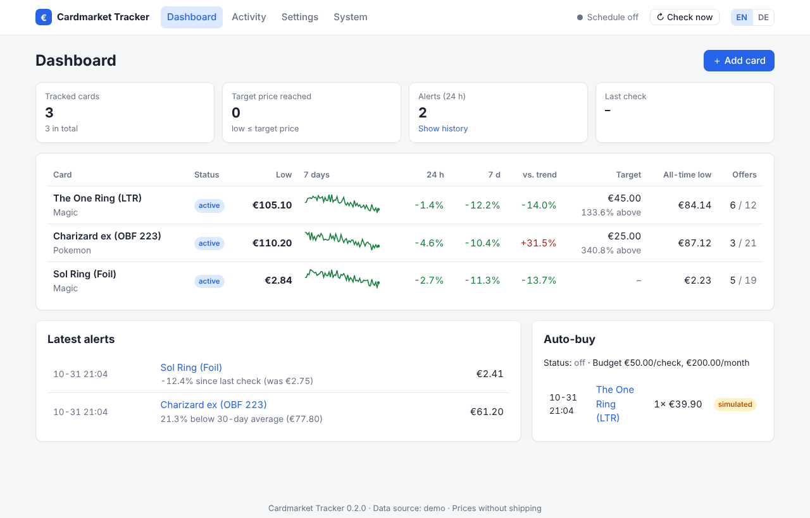
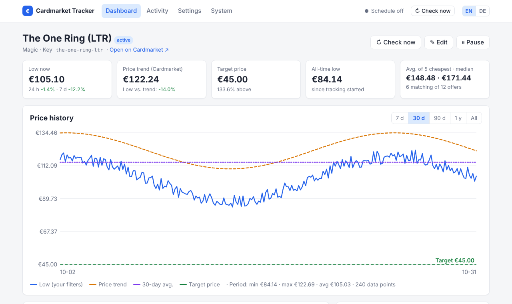
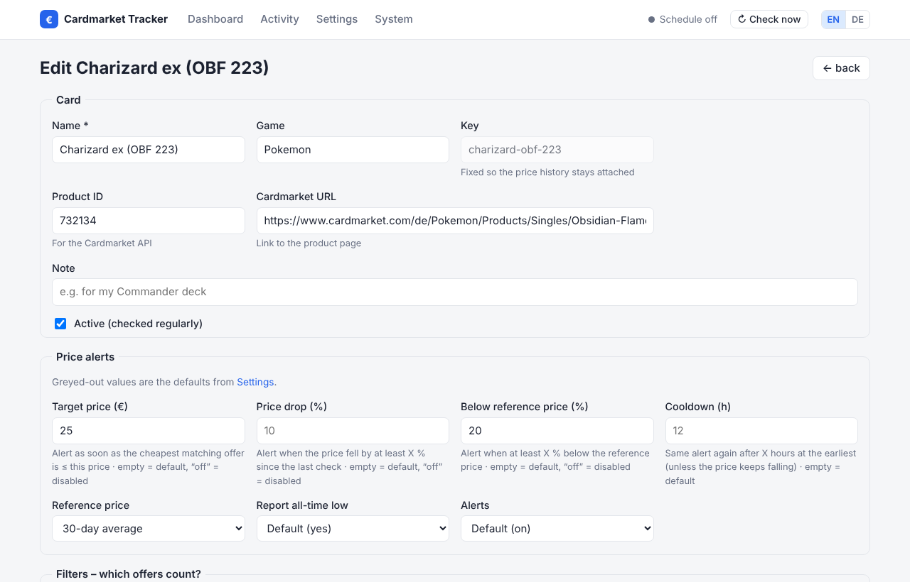

# Web interface

`cmtracker run` starts the tracker **and** the web interface (default port `8080`).

## Language

The interface is available in **English and German**. Switch with **EN / DE** in the top
right corner – the choice is stored in a cookie. Without a choice, the language of your
browser is used (falling back to `general.language`).

Notifications, reports, the command line and the log use `general.language` (`en` or `de`),
which you can change under *Settings → Checks & language*.

## Dashboard

| Column | Meaning |
|---|---|
| Status | *active*, *target reached*, *error* (last check failed), *new* (no data yet), *paused* |
| Low | cheapest offer that matches **your filters** |
| 7 days | sparkline of the low over the last 7 days (green = falling) |
| 24 h / 7 d | change of the low compared with 24 hours / 7 days ago |
| vs. trend | low compared with Cardmarket's price trend |
| Target | your `max_price` alert rule and the distance to it |
| All-time low | lowest low since tracking started |
| Offers | matching offers / all offers |

The header shows the background status (*next check …*) and the **↻ Check now** button. When a check finishes, the page reloads automatically.

## Card page

- **Price history**: range 7 d / 30 d / 90 d / 1 y / all; hover a point to see
  its exact value. Lines: your filtered low, Cardmarket trend, 30-day average, target price.
- Key figures, the cheapest matching offers of the last check, alerts and purchases.
- Buttons: check now, edit, pause / resume.

## Adding and editing cards

Every filter and alert field can be

| Choice | Meaning | Written to `config.yaml` |
|---|---|---|
| *Default* | use the global default | key is removed |
| *any* | explicitly "don't care" | `null` |
| *Selection…* / value | a specific value | the value |

Numeric alert fields: leave empty to use the default, type `off` to disable a rule for this
card. Decimal comma and point are both accepted.

The **key** is fixed after creation, so the price history stays attached even if you rename
the card. When deleting a card you can optionally delete its history as well.

## Settings

*Settings* contains: defaults for all cards (filters and alerts), check schedule,
language of messages, data source, report and auto-buy. Fields filled from environment variables are locked and
marked with an `${ENV}` badge.

## System

*System* shows the background service (last / next check, duration, errors), the configured
notification channels (targets masked), a **test message** button, report generation and
links to the JSON API.

## How saving works

1. The form is validated; errors are shown and nothing is written.
2. `config.yaml` is updated **round-trip**: comments, ordering and `${ENV}` placeholders stay
   untouched. The previous version is kept as `config.yaml.bak`.
3. The background service reloads the configuration immediately – no restart needed.

Manual edits to `config.yaml` are picked up automatically too. If the file becomes invalid,
the UI shows a warning and the last valid configuration keeps running.

!!! info "Not editable in the browser"
    API credentials, notification channels and the web settings themselves (`web:`) are only
    edited in `config.yaml` / `.env`, so secrets cannot be changed or read from the browser.
